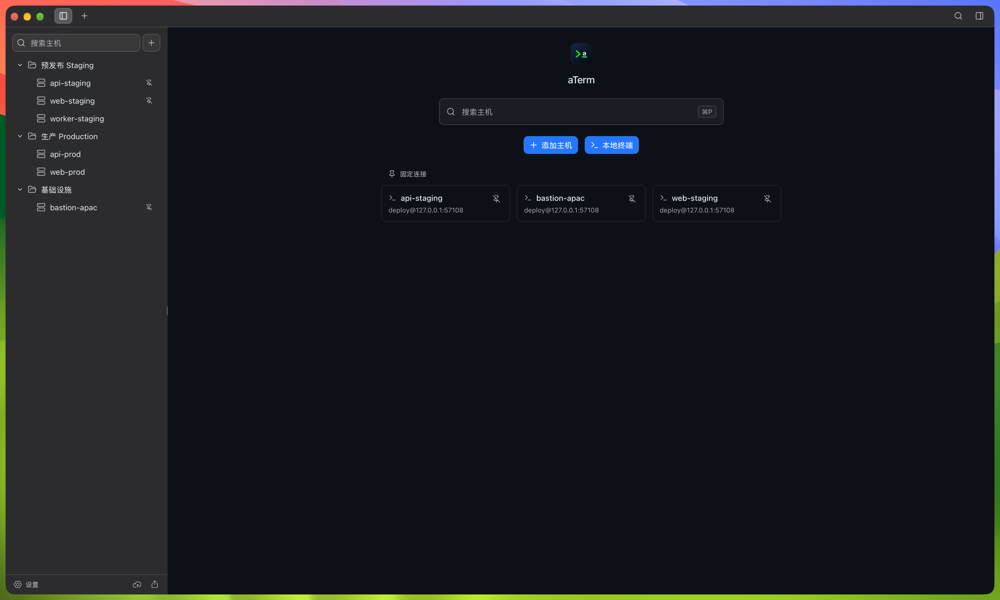
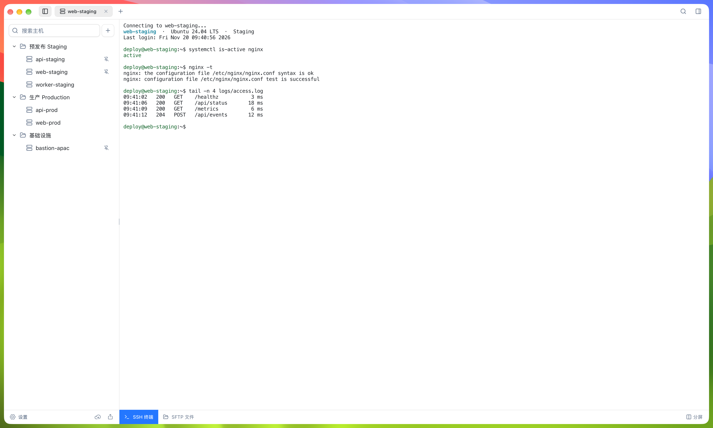
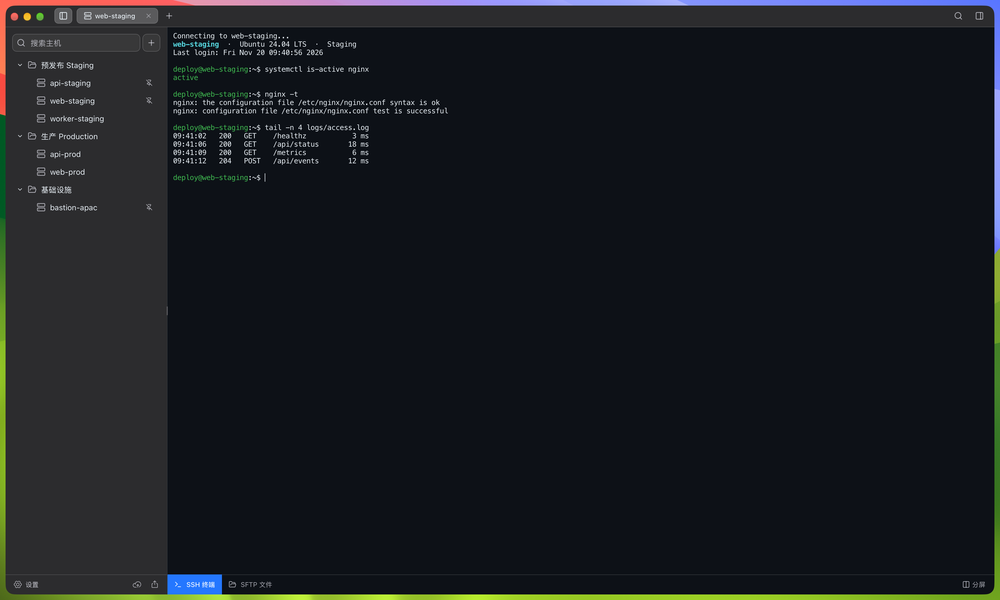
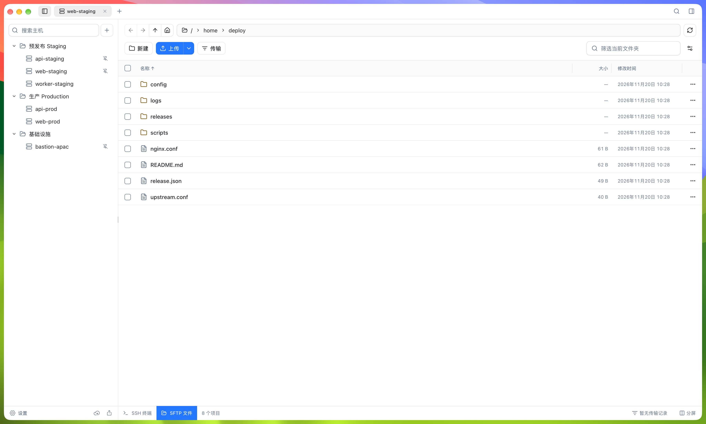
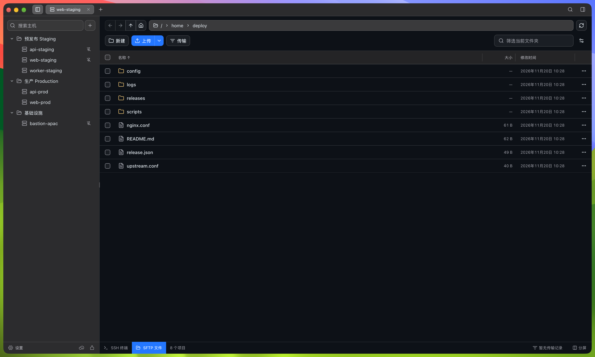

# aTerm

English | [简体中文](README.zh-CN.md)

aTerm is a terminal app for server management and an alternative to Termius. Manage SSH hosts, use local and remote terminals, and work with remote files over SFTP in one workspace.

### Home

Find and open saved SSH hosts from the sidebar or pinned shortcuts.

| Default light | Default dark |
| --- | --- |
|  |  |

### SSH terminal

Check Nginx status and read its access log on the staging host.

| Default light | Default dark |
| --- | --- |
|  |  |

### SFTP files

Browse remote directories and configuration files on the same host.

| Default light | Default dark |
| --- | --- |
|  |  |

## Features

- **Terminals.** Open local shells and SSH sessions in tabs or split panes.
- **Host management.** Organize and search hosts, import SSH settings, and connect with SSH keys and jump hosts.
- **Remote files.** Browse and transfer files over SFTP, and edit remote text files in place.
- **SSH tunnels.** Save and manage [local port forwarding](docs/ssh-tunnels.md) to reach private services.
- **Plugins.** Install plugins and control their permissions.
- **Preferences and backups.** Customize terminal themes and export or restore encrypted backups.

## Download and install

[Download from GitHub Releases](https://github.com/huabeitech/aterm/releases/latest).

- **macOS 12 or later.** Choose the Apple Silicon or Intel ZIP, then extract the app.
- **Windows.** Choose the x64 or ARM64 ZIP, then extract it and run `aTerm.exe`. WebView2 is required.
- **Ubuntu 24.04.** Choose the x64 or ARM64 DEB and run `sudo apt install ./<filename>.deb`.

See the release notes for installation details.

## Feedback and license

Report bugs or suggest features in [GitHub Issues](https://github.com/huabeitech/aterm/issues). aTerm is licensed under [Apache 2.0](LICENSE).
