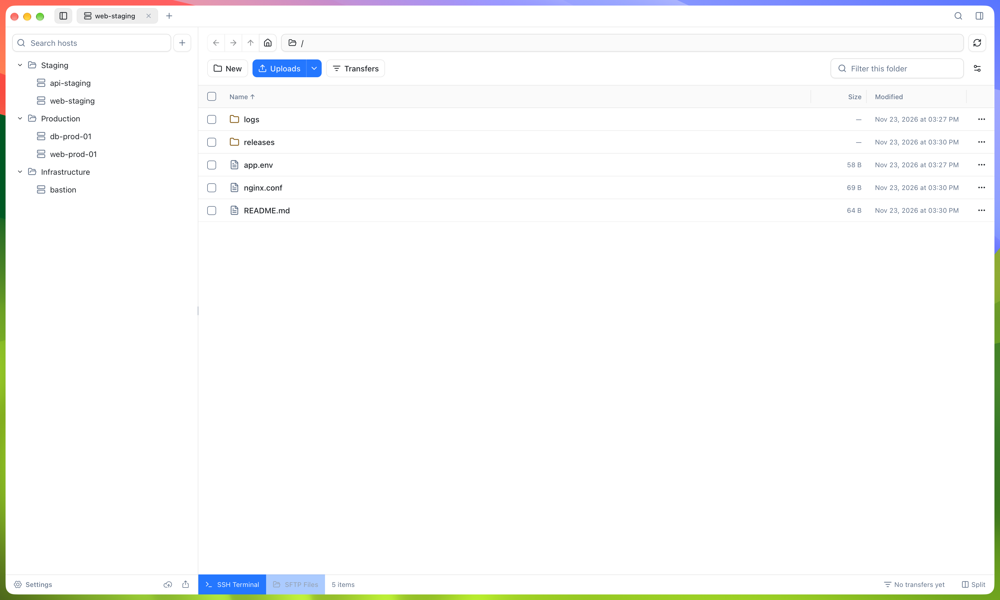

# aTerm

[English](README.md) | 简体中文

aTerm 是一款面向服务器管理的终端应用，也是 Termius 的替代方案。你可以在同一个工作区管理 SSH 主机、使用本地和远程终端，以及通过 SFTP 处理远程文件。

## 界面预览

## 主要功能

- **终端。** 在标签页或分屏中打开本地 Shell 和 SSH 会话。
- **主机管理。** 分组和搜索主机，导入 SSH 配置，使用 SSH 密钥和跳板机连接。
- **远程文件。** 通过 SFTP 浏览、上传和下载文件，直接编辑远程文本文件。
- **SSH 隧道。** 保存和管理[本地端口转发](docs/ssh-tunnels.md)，访问内网服务。
- **插件扩展。** 安装插件并管理插件权限。
- **偏好与备份。** 自定义终端主题，导出和恢复加密备份。

## 下载与安装

[从 GitHub Releases 下载](https://github.com/huabeitech/aterm/releases/latest)。

- **macOS 12 或更高版本。** 下载 Apple Silicon 或 Intel 版 ZIP，然后解压应用。
- **Windows。** 下载 x64 或 ARM64 版 ZIP，解压后运行 `aTerm.exe`，需要 WebView2。
- **Ubuntu 24.04。** 下载 x64 或 ARM64 版 DEB，然后执行 `sudo apt install ./<文件名>.deb`。

更多安装说明见对应版本的发布说明。

## 反馈与许可证

欢迎在 [GitHub Issues](https://github.com/huabeitech/aterm/issues) 提交问题或建议。aTerm 采用 [Apache 2.0 许可证](LICENSE)。
